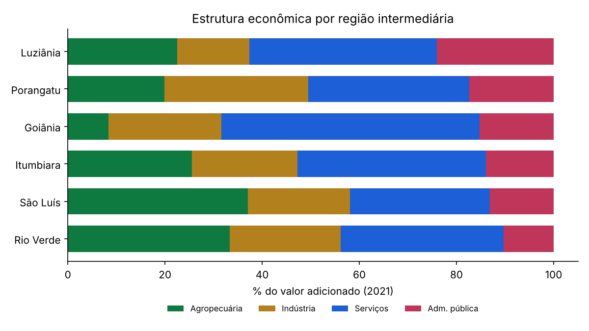
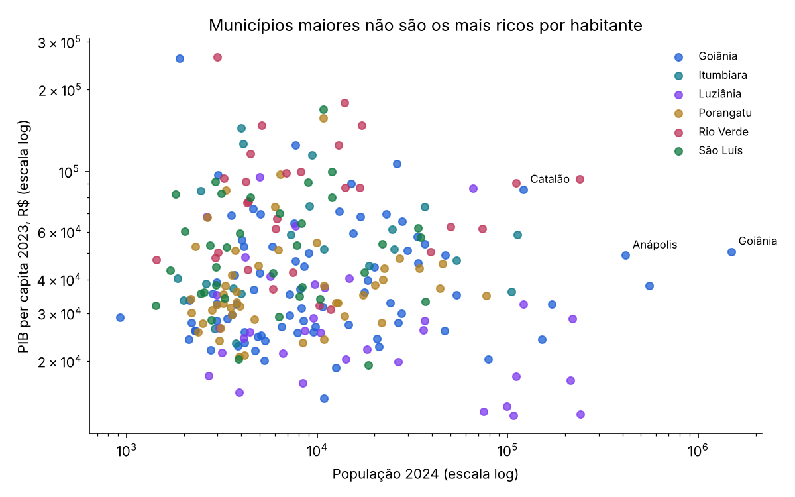
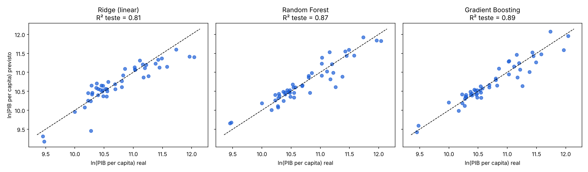

# Radar Imobiliário de Goiás — Projeto Final N2 (Big Data e Data Science)

**FATESG · Tecnologia em Inteligência Artificial · 2026/02**
**Aluno:** Hugo Flávio Vilhena · **Professor:** Reinaldo de Souza Júnior · **Entrega/apresentação:** 17/11/2026

Pergunta do projeto: **a estrutura econômica de um município goiano explica o poder de compra por habitante (PIB per capita), um sinal de demanda para o mercado imobiliário?** Usamos dados públicos do IBGE dos 246 municípios de Goiás, um dashboard com 4 gráficos e três modelos de regressão comparados.

## Estrutura do repositório
```
README.md                  este documento (todos os entregáveis)
dashboard.html             dashboard interativo (Plotly): abrir no navegador
figuras/                   gráficos do dashboard (01-04) e do modelo (05-06)
dados/dados_municipios_goias.csv   base consolidada (246 linhas)
dados/resultados_modelos.csv       métricas dos modelos
dados/importancia_variaveis.csv    importância por permutação
src/                       scripts: build_data.py, dashboard.py, modelagem.py (+ parse.py)
notebook_N2.ipynb          notebook com todo o fluxo
```
Para reproduzir: `pip install pandas scikit-learn matplotlib plotly` e depois `python src/dashboard.py` e `python src/modelagem.py` (a partir da pasta `dados/`, onde está o CSV).

## R1 — Coleta, tratamento e documentação dos dados

**Fonte:** IBGE (Sidra / API de dados agregados), organizados na N1 em 7 tabelas relacionais (PostgreSQL) e consolidadas aqui em uma linha por município:
população estimada (tabela 6579), PIB municipal e valor adicionado por setor (tabela 5938) e domicílios do Censo 2022 (tabela 4712). Recorte: 246 municípios, 6 regiões intermediárias e 22 imediatas de Goiás.

**Resumo analítico.** Municípios que dependem da administração pública (prefeituras, escolas e hospitais públicos) tendem a ter PIB per capita baixo; os que têm indústria, agro e serviços privados fortes tendem a ter PIB per capita alto. Para um corretor ou uma imobiliária, isso indica onde há renda para sustentar aluguel e venda. O estudo mede o quanto dá para prever o PIB per capita só pela estrutura econômica e pelo tamanho do município.

**Tratamento realizado**
1. Junção das 7 tabelas pelo código IBGE (sem nulos, sem duplicidades de município).
2. Conferência de consistência: soma do valor adicionado ≈ 91% (mediana 93%) do PIB, como esperado (o restante são impostos).
3. Cálculo das variáveis derivadas (participação de cada setor, PIB per capita, crescimentos, moradores por domicílio).
4. **Outlier estrutural:** Cachoeira Dourada tem valor adicionado industrial **negativo** em 2021 (−R$ 477 milhões) e PIB que salta de R$ 70 mi para R$ 891 mi até 2023 (efeito de usina hidrelétrica). Foi mantido na base descritiva marcado e **excluído do treino/teste** dos modelos (245 municípios). Os gráficos do dashboard também o omitem.
5. Alvo transformado em **logaritmo**, porque o PIB per capita é muito assimétrico (de R$ 12 mil a R$ 264 mil).

**Dicionário de colunas** (`dados/dados_municipios_goias.csv`)

| Coluna | Descrição |
|---|---|
| cod (índice) | Código IBGE do município (7 dígitos) |
| nome | Nome do município |
| regiao_imediata, regiao_intermediaria | Regiões geográficas IBGE |
| pop_2024, pop_2025 | População estimada (habitantes) |
| pib_2021, pib_2022, pib_2023 | PIB a preços correntes, em R$ mil |
| va_agro, va_ind, va_serv, va_adm | Valor adicionado 2021 (R$ mil): agropecuária, indústria, serviços (exceto adm. pública) e administração/defesa/educação/saúde públicas |
| dom, moradores | Domicílios particulares permanentes ocupados e moradores (Censo 2022) |
| va_total | Soma dos quatro valores adicionados |
| share_agro, share_ind, share_serv, share_adm | Participação de cada setor no valor adicionado total (0 a 1) |
| pib_pc_2021, pib_pc_2023 | PIB per capita em R$ por habitante (pop. 2024 como aproximação) |
| cresc_pop_24_25 | Crescimento populacional 2024 → 2025 |
| cresc_pib_21_23 | Crescimento do PIB 2021 → 2023 |
| moradores_por_dom | Moradores ÷ domicílios (2022) |
| hab_por_dom_2025 | População 2025 ÷ domicílios (2022) |
| log_pop | Logaritmo natural da população 2024 |

## R2 — Dashboard de visualização
Interativo: [`dashboard.html`](dashboard.html). Gráficos estáticos abaixo.





**Leitura:** a região de Goiânia concentra serviços e pouca agropecuária; Rio Verde e São Luís/Iporá dependem mais do agro. O tamanho da população quase não se relaciona com o PIB per capita (correlação −0,05), mas a participação da administração pública se relaciona fortemente e de forma negativa (−0,84).

## R3 — Modelagem preditiva (Machine Learning)

**Tipo de problema: regressão.** O alvo, o PIB per capita 2023, é um valor numérico contínuo, então regressão é a escolha natural; classificação exigiria cortar o valor em faixas e perderia informação.

**Variáveis de entrada:** log da população, participação dos 4 setores (2021), moradores por domicílio, crescimento populacional 2024→25 e a região intermediária (one-hot). Nenhum valor de PIB entra como entrada, para evitar vazamento do alvo.

**Algoritmos e justificativa**
- **Ridge (regressão linear regularizada):** referência simples e interpretável; a regularização lida com a colinearidade entre as participações setoriais.
- **Random Forest:** captura relações não lineares e interações sem ajuste fino; robusto a outliers.
- **Gradient Boosting:** corrige erros em sequência e costuma render o melhor resultado em dados tabulares pequenos.

**Treinamento:** divisão 80/20 (196 treino / 49 teste, `random_state=42`); validação cruzada de 5 partes **apenas no treino** para comparar os modelos; teste final nos 49 municípios nunca vistos. Alvo em ln(PIB per capita).

**Resultados**

| Modelo | R² (validação cruzada 5-fold) | R² (teste) | MAE (teste, R$ por hab.) | RMSE (teste, ln) |
|---|---|---|---|---|
| Ridge (linear) | 0.764 ± 0.067 | 0.812 | 10.144 | 0.241 |
| Random Forest | 0.783 ± 0.033 | 0.875 | 8.682 | 0.197 |
| Gradient Boosting | 0.807 ± 0.048 | 0.893 | 8.525 | 0.182 |

Um modelo ingênuo que prevê sempre a média do treino tem R² ≈ −0,04 e erro médio de R$ 23.548 por habitante.




**Comparação.** Os três modelos superam muito a referência ingênua. O Gradient Boosting foi o melhor (R² 0,89 no teste, erro médio ≈ R$ 8,5 mil por habitante, cerca de um terço do erro da média). Random Forest ficou próximo e o Ridge foi o mais fraco, o que indica alguma não linearidade. A diferença entre Gradient Boosting e Random Forest é pequena frente à variação entre partições (desvio ≈ 0,03–0,05 na validação cruzada), então não dá para afirmar superioridade clara entre os dois.

**Variável mais importante:** a participação da administração pública no valor adicionado (embaralhá-la derruba o R² em mais de 1,6 ponto). Todas as outras têm efeito pequeno.

## Conclusões e limitações
- Dá para prever bem o poder de compra por habitante a partir da estrutura econômica: municípios com muita administração pública tendem a ser mais pobres por habitante.
- Para o mercado imobiliário, isso ajuda a priorizar municípios com economia privada diversificada.
- **Limitações:** só 245 municípios, o que deixa o R² de teste (49 casos) sujeito a oscilação; estrutura econômica de 2021 explicando PIB de 2023; PIB per capita usa população 2024 como aproximação; a base é municipal e não traz preços de imóveis, então o estudo mede renda, não valor de venda ou aluguel.
- **Próximos passos:** incorporar preços de anúncios e dados de IPTU de Goiânia, e testar uma classificação "alta demanda × baixa demanda".
