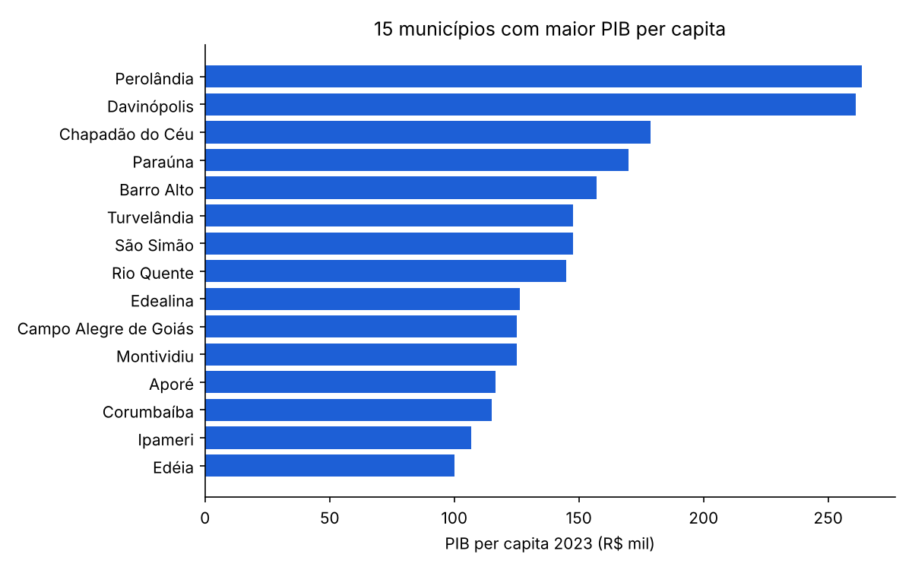
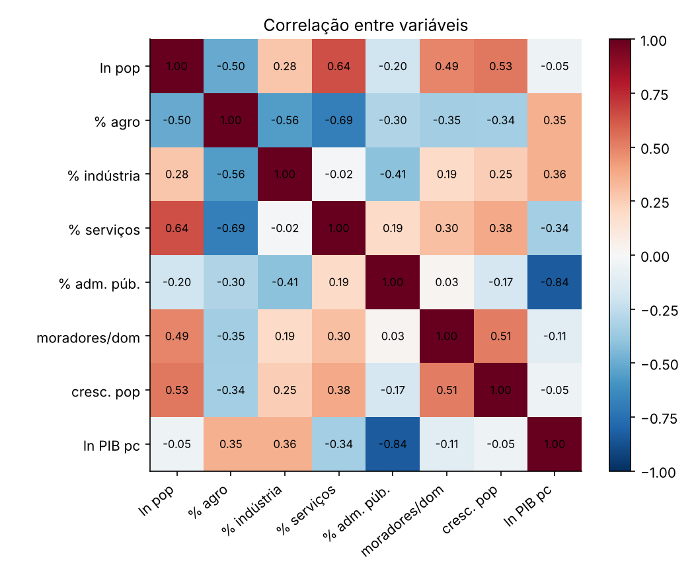
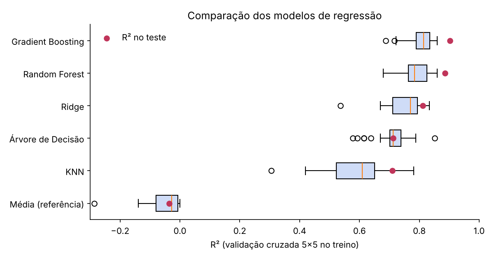
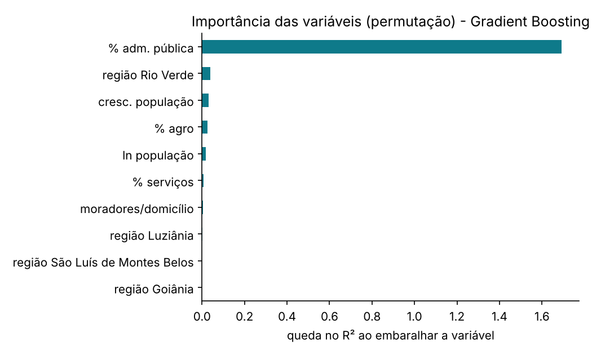
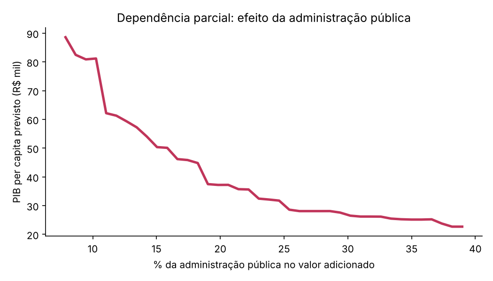
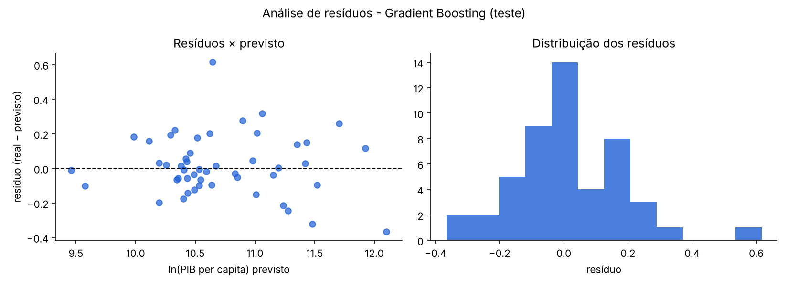
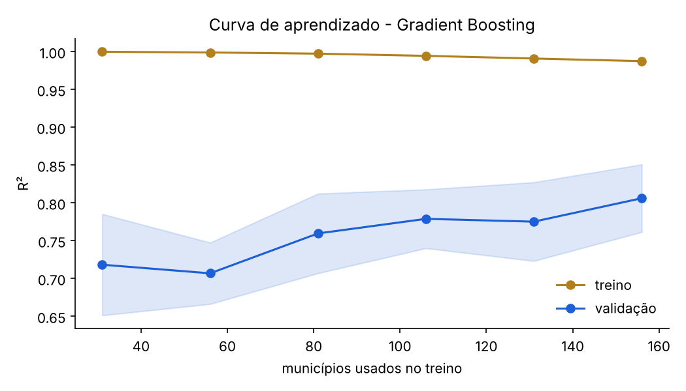
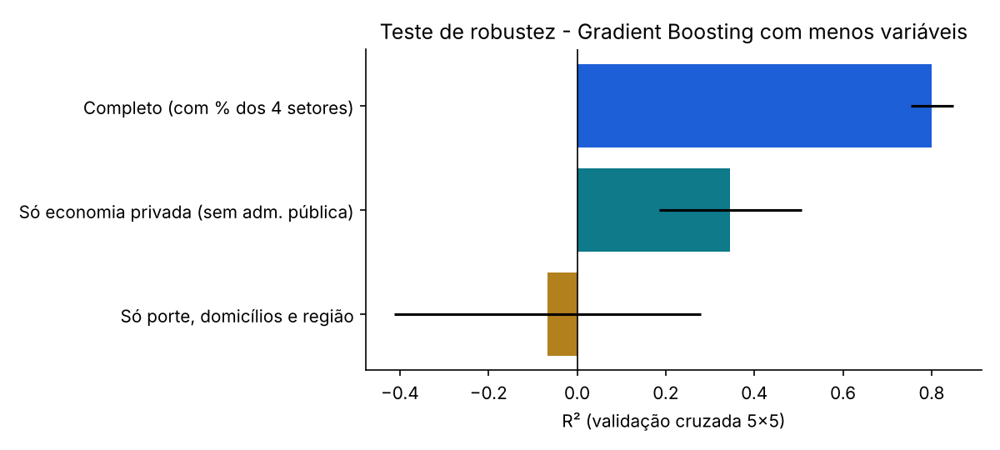
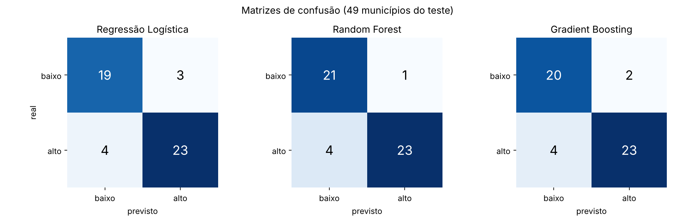
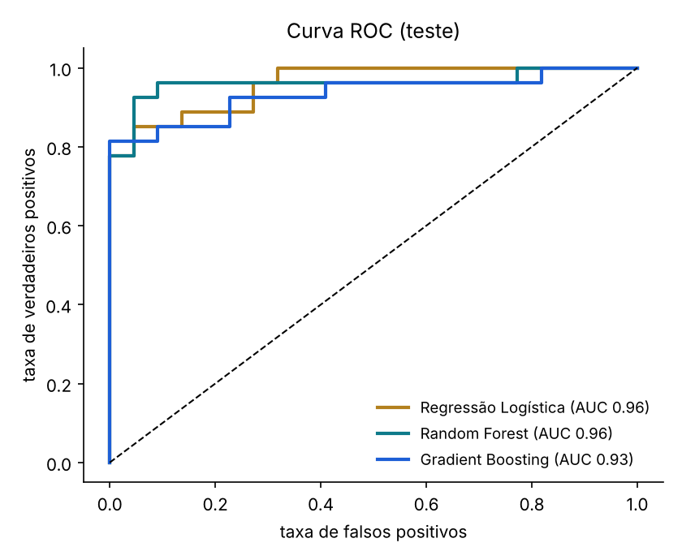

# Radar Imobiliário de Goiás — Projeto Final N2 (Big Data e Data Science)

**FATESG · Tecnologia em Inteligência Artificial · 2026/02**
**Integrantes do grupo:** Hugo Flávio Vilhena, Ricardo César Santana e Ana Maria Lima Quartiero
**Professor:** Reinaldo de Souza Júnior · **Entrega/apresentação:** 17/11/2026

Pergunta do projeto: **a estrutura econômica de um município goiano explica o poder de compra por habitante (PIB per capita), um sinal de demanda para o mercado imobiliário?** Usamos dados públicos do IBGE dos 246 municípios de Goiás, um painel com 13 gráficos, cinco algoritmos de regressão comparados com ajuste de hiperparâmetros, um teste de robustez e uma classificação complementar com três algoritmos.

## Estrutura do repositório
```
README.md                  este documento (todos os entregáveis)
dashboard.html             painel de apresentação (Plotly, 13 gráficos): arquivo único, abre no navegador sem internet
figuras/                   gráficos do dashboard (01-04) e dos modelos (05-13)
dados/dados_municipios_goias.csv   base consolidada (246 linhas)
dados/resultados_modelos.csv       métricas da regressão
dados/resultados_classificacao.csv métricas da classificação
dados/ablacao.csv                  teste de robustez
dados/previsoes_teste.csv          previsto x real por município do teste
dados/*.csv, meta_modelos.json     demais saídas (importância, curva de aprendizado, erro por região, hiperparâmetros)
src/                       scripts: build_data.py, dashboard.py, dashboard_apresentacao.py, modelagem.py (+ parse.py)
notebook_N2.ipynb          notebook com todo o fluxo
```
Para reproduzir, a partir da raiz do repositório: `pip install pandas scikit-learn matplotlib plotly` e depois `python src/dashboard.py` (gráficos 01-04), `python src/modelagem.py` (modelos, gráficos 05-13 e CSVs de resultado) e `python src/dashboard_apresentacao.py` (gera `painel_apresentacao.html`, publicado aqui como `dashboard.html`).

## R1 — Coleta, tratamento e documentação dos dados

**Fonte:** IBGE (Sidra / API de dados agregados), organizados na N1 em 7 tabelas relacionais (PostgreSQL) e consolidadas aqui em uma linha por município:
população estimada ([tabela 6579](https://sidra.ibge.gov.br/tabela/6579)), PIB municipal e valor adicionado por setor ([tabela 5938](https://sidra.ibge.gov.br/tabela/5938)) e domicílios do Censo 2022 ([tabela 4712](https://sidra.ibge.gov.br/tabela/4712)). Recorte: 246 municípios, 6 regiões intermediárias e 22 imediatas de Goiás.

**Resumo analítico.** Municípios que dependem da administração pública (prefeituras, escolas e hospitais públicos) tendem a ter PIB per capita baixo; os que têm indústria, agro e serviços privados fortes tendem a ter PIB per capita alto. Para um corretor ou uma imobiliária, isso indica onde há renda para sustentar aluguel e venda. O estudo mede o quanto dá para prever o PIB per capita só pela estrutura econômica e pelo tamanho do município.

**Tratamento realizado**
1. Junção das 7 tabelas pelo código IBGE (sem nulos, sem duplicidades de município).
2. Conferência de consistência: soma do valor adicionado ≈ 91% (mediana 93%) do PIB, como esperado (o restante são impostos).
3. Cálculo das variáveis derivadas (participação de cada setor, PIB per capita, crescimentos, moradores por domicílio).
4. **Outlier estrutural:** Cachoeira Dourada tem valor adicionado industrial **negativo** em 2021 (−R$ 477 milhões) e PIB que salta de R$ 70 mi para R$ 891 mi até 2023 (efeito de usina hidrelétrica). Foi mantido na base descritiva marcado e **excluído do treino/teste** dos modelos (245 municípios). Os gráficos do dashboard também o omitem.
5. Alvo transformado em **logaritmo**, porque o PIB per capita é muito assimétrico (de R$ 12 mil a R$ 264 mil).

**Dicionário de colunas** (`dados/dados_municipios_goias.csv`)

| Coluna | Descrição |
|---|---|
| cod (índice) | Código IBGE do município (7 dígitos) |
| nome | Nome do município |
| regiao_imediata, regiao_intermediaria | Regiões geográficas IBGE |
| pop_2024, pop_2025 | População estimada (habitantes) |
| pib_2021, pib_2022, pib_2023 | PIB a preços correntes, em R$ mil |
| va_agro, va_ind, va_serv, va_adm | Valor adicionado 2021 (R$ mil): agropecuária, indústria, serviços (exceto adm. pública) e administração/defesa/educação/saúde públicas |
| dom, moradores | Domicílios particulares permanentes ocupados e moradores (Censo 2022) |
| va_total | Soma dos quatro valores adicionados |
| share_agro, share_ind, share_serv, share_adm | Participação de cada setor no valor adicionado total (0 a 1) |
| pib_pc_2021, pib_pc_2023 | PIB per capita em R$ por habitante (pop. 2024 como aproximação) |
| cresc_pop_24_25 | Crescimento populacional 2024 → 2025 |
| cresc_pib_21_23 | Crescimento do PIB 2021 → 2023 |
| moradores_por_dom | Moradores ÷ domicílios (2022) |
| hab_por_dom_2025 | População 2025 ÷ domicílios (2022) |
| log_pop | Logaritmo natural da população 2024 |

## R2 — Dashboard de visualização
**Painel online: https://hugovilhenagyn.github.io/radar-imobiliario-goias-n2/dashboard.html**

Painel interativo com os números principais, os 4 gráficos abaixo e os 9 gráficos dos modelos: baixe o [`dashboard.html`](dashboard.html) e abra no navegador (funciona sem internet). O GitHub mostra esse arquivo como código. Gráficos estáticos abaixo.





**Leitura:** a região de Goiânia concentra serviços e pouca agropecuária; Rio Verde e São Luís/Iporá dependem mais do agro. O tamanho da população quase não se relaciona com o PIB per capita (correlação −0,05), mas a participação da administração pública se relaciona fortemente e de forma negativa (−0,84).

## R3 — Modelagem preditiva (Machine Learning)

Código completo em [`src/modelagem.py`](src/modelagem.py) e no notebook. São três partes: **A)** regressão, que é o problema principal; **B)** teste de robustez; **C)** classificação complementar.

### A. Regressão: prever o PIB per capita 2023

**Por que regressão.** O alvo é um valor numérico contínuo (R$ por habitante), então regressão é a técnica adequada ao problema.

**Variáveis de entrada (13):** log da população, participação dos 4 setores no valor adicionado de 2021, moradores por domicílio, crescimento populacional 2024→25 e a região intermediária (6 colunas one-hot). O alvo é o logaritmo do PIB per capita 2023.

**Algoritmos e justificativa**

| Algoritmo | Por que foi incluído |
|---|---|
| Média (referência) | Piso de comparação: qualquer modelo útil precisa ser melhor do que prever sempre a média |
| Ridge | Modelo linear regularizado, simples e interpretável; a regularização lida com a colinearidade entre as participações setoriais |
| KNN | Prevê pela média dos municípios mais parecidos; testa se "vizinhos" de perfil econômico bastam |
| Árvore de Decisão | Regras do tipo "se a adm. pública pesa mais que X%"; fácil de explicar, mas instável |
| Random Forest | Média de muitas árvores; capta não linearidades e reduz a instabilidade da árvore única |
| Gradient Boosting | Árvores em sequência, cada uma corrigindo o erro da anterior; costuma ser o melhor em tabelas pequenas |

**Processo de treinamento**
1. Divisão 80/20 com semente fixa: **196 municípios de treino e 49 de teste**. O teste só é usado no final.
2. Ajuste de hiperparâmetros com `GridSearchCV` (validação cruzada de 5 partes) **apenas no treino**.
3. Comparação dos modelos por validação cruzada repetida (5 partes × 5 repetições = 25 avaliações cada), também só no treino.
4. O melhor modelo é escolhido **pela validação cruzada**, não pelo teste, para que o teste continue sendo uma medida honesta.
5. Modelos sensíveis a escala (Ridge e KNN) usam padronização dentro de um `Pipeline`, ajustada só com os dados de treino de cada partição.

| Modelo | Hiperparâmetros escolhidos (GridSearchCV, 5 partes, só no treino) |
|---|---|
| Ridge | `alpha=1` |
| KNN | `n_neighbors=5`, `weights=distance` |
| Árvore de Decisão | `max_depth=6`, `min_samples_leaf=10` |
| Random Forest | `max_depth=10`, `max_features=1.0`, `min_samples_leaf=1`, `n_estimators=300` |
| Gradient Boosting | `learning_rate=0.03`, `max_depth=3`, `n_estimators=300`, `subsample=0.8` |

**Resultados**

| Modelo | R² validação cruzada (5×5) | R² teste | MAE teste (R$/hab.) | RMSE teste (R$/hab.) | MAPE teste |
|---|---|---|---|---|---|
| Gradient Boosting | 0,801 ± 0,048 | 0,902 | 8.204 | 13.731 | 12,6% |
| Random Forest | 0,786 ± 0,051 | 0,886 | 8.230 | 12.522 | 13,8% |
| Ridge | 0,755 ± 0,065 | 0,812 | 10.144 | 18.136 | 16,3% |
| Árvore de Decisão | 0,708 ± 0,062 | 0,713 | 14.339 | 23.916 | 21,6% |
| KNN | 0,591 ± 0,107 | 0,710 | 13.400 | 24.519 | 19,5% |
| Média (referência) | -0,052 ± 0,062 | -0,036 | 23.548 | 35.905 | 42,6% |

MAE, RMSE e MAPE estão em reais (a previsão em log é convertida de volta). R² é calculado no logaritmo do alvo.




**Comparação.** Todos os algoritmos superam com folga a referência pela média (R² -0,04 e erro médio de R$ 23.548 por habitante). O **Gradient Boosting** teve o melhor R² na validação cruzada (0,801) e foi o escolhido: no teste chega a R² 0,902, com erro médio de R$ 8.204 por habitante (12,6% em média). O Random Forest fica praticamente empatado (0,786 na validação cruzada), diferença menor que o desvio entre as partições (≈ 0,05), então não há superioridade clara entre os dois. Ridge vem a seguir; Árvore de Decisão e KNN ficam atrás. O R² do teste é mais alto que o da validação cruzada em quase todos os modelos, o que indica uma partição de teste favorável: o número mais confiável é o da validação cruzada, perto de 0,80.

**Diagnóstico do melhor modelo**






- **Importância por permutação:** a participação da administração pública domina; embaralhá-la derruba o R² em cerca de 1,7. As demais variáveis têm efeito pequeno.
- **Dependência parcial:** a previsão cai de cerca de R$ 89 mil por habitante, quando a administração pública pesa 8% do valor adicionado, para cerca de R$ 23 mil quando pesa 39%.
- **Resíduos:** centrados em zero e sem padrão evidente; há um município subestimado com resíduo acima de 0,6 (em log).
- **Curva de aprendizado:** o R² de treino fica perto de 1 e o de validação perto de 0,8. Há sobreajuste, esperado nesse tipo de modelo com poucos dados, e a validação ainda sobe com mais municípios.

**Erro por região (teste, Gradient Boosting)**

| Região intermediária | Municípios no teste | Erro percentual médio |
|---|---|---|
| Goiânia | 14 | 8,8% |
| Itumbiara | 3 | 19,6% |
| Luziânia | 5 | 8,7% |
| Porangatu | 10 | 10,0% |
| Rio Verde | 8 | 19,1% |
| São Luís de Montes Belos | 9 | 15,6% |

Com poucos municípios por região no teste, essas médias são apenas indicativas.

### B. Teste de robustez: de onde vem o poder de previsão

A participação da administração pública é quase um espelho do nível de renda: o valor adicionado da administração pública acompanha a população, então a sua participação é alta onde o restante da economia é pequeno. A correlação entre ela e o logaritmo do PIB per capita de **2021** é de -0,84. Ou seja, mesmo sem usar o PIB diretamente como entrada, essa variável carrega informação do PIB per capita de dois anos antes. Para medir isso, o melhor modelo foi retreinado com menos variáveis:

| Variáveis de entrada | R² validação cruzada | R² teste | MAE teste (R$/hab.) |
|---|---|---|---|
| Completo (com % dos 4 setores) | 0,801 ± 0,048 | 0,902 | 8.204 |
| Só economia privada (sem adm. pública) | 0,346 ± 0,161 | 0,567 | 14.737 |
| Só porte, domicílios e região | -0,067 ± 0,346 | 0,161 | 21.286 |



**Leitura honesta:** o R² de 0,80 depende dessa variável. Usando só a composição da economia privada (peso do agro e da indústria, sem a administração pública), o R² cai para cerca de 0,35; só com porte, domicílios e região, o modelo não é melhor que a média. A conclusão correta é que o modelo identifica bem **quais municípios dependem do setor público, e esses são os de menor renda por habitante**; ele não descobre a renda a partir de informações independentes dela.

### C. Classificação complementar: município de alto ou baixo PIB per capita

Para a decisão prática de priorizar ou não um município, o alvo foi transformado em duas classes: **alto** (acima da mediana do treino, R$ 37.791 por habitante) e **baixo**. As classes ficam equilibradas; quem chutasse sempre a classe mais comum no teste acertaria 55%. Mesmas 13 variáveis e mesma divisão treino/teste; validação cruzada estratificada de 5 partes no treino.

- **Regressão Logística:** referência linear e interpretável para classificação.
- **Random Forest** e **Gradient Boosting:** versões de classificação dos dois melhores modelos da regressão.

| Modelo | Acurácia (CV) | AUC (CV) | Acurácia | Precisão | Recall | F1 | AUC |
|---|---|---|---|---|---|---|---|
| Regressão Logística | 0,872 | 0,940 | 0,857 | 0,885 | 0,852 | 0,868 | 0,960 |
| Random Forest | 0,877 | 0,942 | 0,898 | 0,958 | 0,852 | 0,902 | 0,961 |
| Gradient Boosting | 0,867 | 0,943 | 0,878 | 0,920 | 0,852 | 0,885 | 0,934 |




**Comparação.** Os três classificadores ficam empatados na validação cruzada (acurácia ≈ 0,87 e AUC ≈ 0,94). No teste acertam entre 42 e 44 dos 49 municípios, e cada um deixa de reconhecer 4 dos 27 municípios de alto PIB per capita (recall 0,85). A Regressão Logística, mais simples, entrega o mesmo resultado dos modelos de árvores. A ressalva da parte B vale aqui também.

## Conclusões e limitações
- A estrutura econômica separa bem os municípios goianos por renda por habitante: R² ≈ 0,80 na regressão e acurácia ≈ 0,87 na classificação, ambos em validação cruzada.
- O fator decisivo é o peso da administração pública: onde ele é alto, o PIB per capita é baixo. Para o mercado imobiliário, isso aponta os municípios com economia privada mais forte como os de maior poder de compra.
- **Limitações:**
  - a participação da administração pública espelha em parte o próprio nível de renda de 2021; sem ela o R² cai para ≈ 0,35 (parte B);
  - são só 245 municípios, e o teste com 49 oscila (o R² do teste saiu acima da validação cruzada);
  - a estrutura econômica é de 2021 e o alvo é de 2023; o PIB per capita usa a população de 2024 como aproximação;
  - a base é municipal e não traz preços de imóveis: o estudo mede renda, não valor de venda ou aluguel.
- **Próximos passos:** incorporar preços de anúncios e dados de IPTU de Goiânia, incluir variáveis independentes da renda (emprego formal, crédito, frota) e validar por região (treinar em umas e testar em outras).
